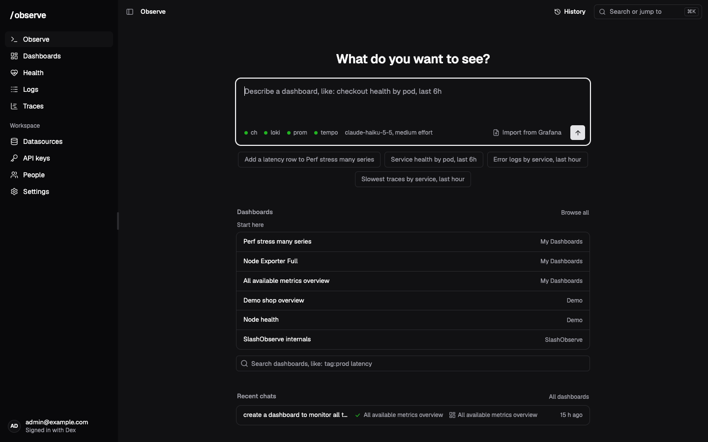
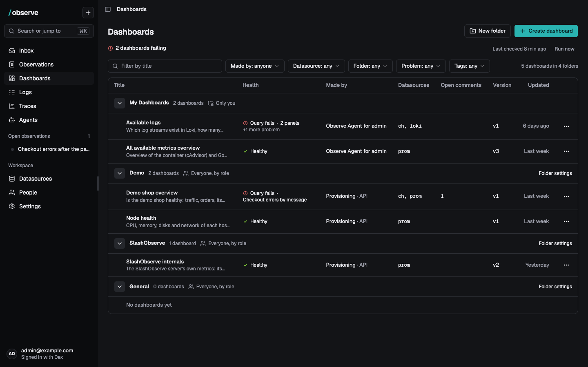
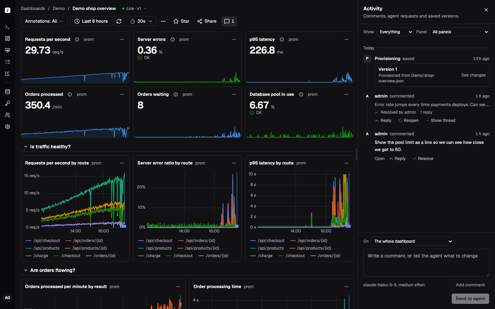

This page walks a team through the move from Grafana in the order that works: each step leaves the dashboards in a better state for the next one.

1. [Connect](#connect) the server to a running Grafana.
2. [Import](#import) every dashboard with its folders in one run.
3. [Repair](#repair) the panels whose queries did not verify.
4. [Check health](#check-health) to find what still returns no data, and what nobody uses.
5. [Share](#share-with-public-links-and-tv-mode) dashboards with people outside the team and on wall screens.
6. [Keep dashboards in Git](#keep-dashboards-in-git) once they are right.
7. [Open old links](#open-old-links) to Grafana dashboards at their new address.

[What maps, what changes and what waits](#what-maps-what-changes-and-what-waits) compares the two in one table, and [The API](#the-api) does every step without the web app.
The screenshots on this page come from an earlier build of the app, so the sidebar and some labels differ from what you see now.
None of them shows the connection form, the import report or the repair queue.

## Before you start

You need two things, one on each side.

1. Set `SLASHOBSERVE_SECRET_KEY` on the server; see [Configuration](../reference/configuration.md#stored-secrets).
   The server encrypts each token with a key derived from it, and adding a connection without it fails with `409 secret_key_missing`.
2. In Grafana, create a service account with the Viewer role on the folders you want to bring over, and a token for it.

The server only reads from Grafana: `/api/health`, `/api/folders`, `/api/search`, `/api/datasources` and `/api/dashboards/uid/<uid>`.

The chat page at `/ask` lists the dashboards you can see below the chat composer, with **Import from Grafana** beside the composer's datasources.



## Connect

An Admin stores a Grafana URL and a service-account token once, and the server then imports every dashboard from that Grafana, instead of one file at a time.
Each dashboard goes through the same importer as [Import Grafana dashboards](import-grafana.md), with the same datasource matching, the same report and one import record per dashboard.

1. Open Settings and choose **Grafana connection** in its section list.
   Only Admins see it.
2. Choose **Add connection**.
3. In the panel that opens, give the connection a name, the Grafana URL and the service-account token, and choose **Add connection**.

The token is stored encrypted and is never shown again, not in the web app and not in the API.
The server tests the connection as soon as it is saved, and a message says whether the test passed or what failed.
A failed test still keeps the connection, so you can fix it with Edit instead of adding it again.

From a shell, an Admin key does the same:

```sh
printf '%s' "$GRAFANA_TOKEN" | observe grafana connect https://grafana.example.com --token-stdin
```

See [CLI](cli.md#import-from-a-grafana) for the output and the exit codes.

### Test a connection again

Choose **Test** on the connection.
The outcome names how many top-level folders and dashboards the server found, for example `Connected: 12 top-level folders, 340 dashboards.`
A Grafana that cannot be reached or refuses the token shows a fixed message such as `Grafana refused the token (status 401).`

### Change or delete a connection

Choose **Edit** in the row's menu to change the name, the URL or the token.
Leave the token empty to keep the stored one.
A new URL needs the token again, so a stored token never reaches another host.
Saving tests the connection again.

Deleting a connection from the same menu keeps the dashboards it imported.

### Who can connect, and why private hosts are allowed

Only Admins can add, change, test, list or delete a connection, or start an import from one.
A key needs the Admin role too.
The token is never returned by the API, never logged, and only ever sent to the host of the connection's URL.

Other outbound fetches, such as news feeds and images, reach only `https` on port 443 and refuse private addresses; see [Outbound access](../operate/outbound-access.md).
A Grafana connection is the one exception: its URL may be `http` or `https` on any port, and its host may resolve to a private or loopback address, because Grafana usually runs inside the same network as SlashObserve.
This is safe to allow only because the person adding the URL is an Admin, who already controls the server's datasources and settings.

The host must still be a domain name, not an IP address, and it must be on the outbound allowlist.
Adding a connection allows its domain when the list is managed in Settings.
It is refused with `403 outbound_domain_not_allowed` when `SLASHOBSERVE_OUTBOUND_DOMAINS` locks the list and does not name it.
Deleting the connection removes that entry again unless something else still uses the host.
Every request to Grafana keeps the outbound timeout and an 8 MiB size cap, and a redirect is never followed.

## Import

1. Choose **Import** on a connection.
2. Pick **All folders**, or **Choose folders** and tick the ones you want.
   A folder brings its subfolders with it, and General stands for the dashboards outside any folder.
3. Check the datasource matches.
   A datasource with no match is flagged: dashboards that use it fail until you pick one.
4. Choose **Start import**.

The page shows how many dashboards are done out of the total, and how many failed or were skipped, while the import runs.
It keeps showing the run after a reload.
When the import ends, the results are grouped:

- Failed: the dashboards that could not be imported, each with its Grafana uid and the reason.
- Need repair: the dashboards that were imported with unverified or placeholder panels, with their counts and a link to each.
- Imported: the dashboards that imported cleanly.
- Skipped: the dashboards already imported at the same Grafana version.

To stop a running import, an Admin chooses **Stop import** on its progress card.
The dashboards it already imported stay.

From a shell, `observe grafana import <connection id> --all` does the same; see [CLI](cli.md#import-from-a-grafana).

### How datasources are matched

Each Grafana datasource of a type SlashObserve queries (Prometheus, ClickHouse, Loki, Tempo, Elasticsearch or OpenSearch) is listed with a choice of your datasources of the same type.
The importer's automatic rules prefill the choice, so a datasource of the wrong type is never offered.
A datasource whose type has no configured datasource here is listed without a choice, and its panels import as placeholders that say which type is missing.
Datasources of other types are counted in one line, and their panels import as placeholders.

### How an import runs

The server fetches at most 4 dashboards from Grafana at a time and saves them one after another, and a dashboard that fails never stops the run.
A connection runs one import at a time.
Any server answers the progress of an import, and each connection keeps its last 20 imports.
The connection's last import is the newest finished one.

A server that stops hands a running import on, and the next server continues it by skipping the dashboards already handled.
An import whose server crashes twice ends failed, and starting it again skips what it already imported.

## Repair

The repair queue is the **Imported, not verified** problem filter on the dashboards list, at `/dashboards?kind=imported`.
The old address `/import/repair` opens it too.
It lists, in the folders you can see, every dashboard whose latest version still has unverified panels or variables or placeholder panels.
Editors and Admins can open it from Import from Grafana, and from the Need repair group of an import's results.

Each row shows the dashboard's folder, its unverified panels and variables, its placeholders, when it was imported, and its latest repair.
A dashboard leaves the list once nothing in it fails.

1. Choose **Repair** on a row to queue one revision by the agent on that dashboard.
2. To queue every listed dashboard in the chosen folder, choose **Repair all**.
3. Open the dashboards when the revisions finish, and send a repair again where one is still failing.

Every repair uses this fixed prompt:

```text
Repair every panel and variable listed as unverified so its query runs and returns data; keep every other panel unchanged and never delete an unverified panel.
```

A repair that ran but left failures shows as repaired and still failing, and you can send it again.
A dashboard with a revision already queued or running is skipped, and so is one with only placeholders, because the agent never edits a placeholder; replace those by hand.
Each person can have 20 repairs queued or running, so on a large import run Repair all again when the first ones finish.

From an MCP client, read the dashboard with `get_dashboard`, whose `unverified` list names the failing panels and variables, and fix those panels with `update_panels`.

## Check health

Repair fixes what failed at import time, but a query that runs can still return nothing, and a move is a good time to drop dashboards nobody opens.
Every dashboard is checked about once a day, and the dashboards list marks each one that has any of these:

- a panel that fails or returns no data over the last 7 days;
- a variable that resolves to nothing;
- a duplicate title in its folder;
- no opens in 90 days.

After a large import, an Admin can choose **Run now** instead of waiting for the hourly run, and an Editor can choose **Repair** on a row to queue the agent on its failing panels.
Delete or merge the duplicates and the unopened dashboards before the next step, so nobody shares or commits them.
See [Dashboard health](dashboard-health.md) for the rules and the API.



## Share with public links and TV mode

Grafana's public dashboards and kiosk mode have their counterparts here.



### Give someone without an account a public link

A [public link](public-links.md) lets someone without an account, such as a vendor or a status screen, open one dashboard at `/p/<token>`.

1. Open the dashboard and choose **Share**.
   You need to manage the dashboard's folder.
2. Create the link, choose whether viewers may change the variables, and optionally set an expiry.
3. Send the `/p/<token>` address.
   Revoke it from the same pane at any time.

A public view runs only that dashboard's saved queries and never shows query text, annotations, comments or the agent.
A dashboard in My Dashboards, or one whose queries read the viewer's identity, cannot have a link; [Public links](public-links.md#dashboards-that-cannot-have-a-link) lists the cases.

### Show a dashboard on a wall screen

TV mode shows a dashboard full screen without the top row, the variables bar, the links or the activity card, and Esc leaves it.
Add these keys to the dashboard's address:

- `kiosk=true` starts TV mode.
- `cycle=rows` scrolls through its rows.
- `cycle=folder` moves through its folder's dashboards, which takes the place of a Grafana playlist.
- `interval=<seconds>` sets the pace, 60 by default.

See [Show it on a wall](public-links.md#show-it-on-a-wall).

## Keep dashboards in Git

Once a folder is right, export it and commit the files, so a change goes through review like code:

```sh
observe dashboards export Payments --dir dashboards
observe dashboards apply --dir dashboards
```

Apply saves each file into the dashboard it came from, adopts a dashboard with the same title in the folder, and never deletes one, so a CI job can run it on every merge.
It takes the place of Grafana's provisioning files when you would rather not mount a directory on the server.
The server's own [provisioning directory](../operate/provisioning.md) reads the same layout.
See [Dashboards as code](dashboards-as-code.md) for the layout, the matching rule and a GitHub Actions workflow.

## Open old links

A Grafana dashboard link keeps working with its host changed to SlashObserve's.
`/d/<grafana uid>/<slug>` redirects with `302 Found` to `/d/<id>` of the imported dashboard, keeping the slug and the query string, as [Old addresses](web.md#old-addresses) describes.

`GET /api/v1/grafana/resolve/{uid}` answers the `dashboard_id` and the web `url` of the dashboard imported from a Grafana uid.
Any signed-in person can call it, and a uid whose dashboard is in a folder they cannot see answers `404`, like a uid nobody imported.

## The API

Everything in the Grafana connection section is also in the HTTP API for Admins and Admin keys, and the repair queue for Editors and Admins.
The health list and apply have their own APIs, described in [Dashboard health](dashboard-health.md#api) and [Dashboards as code](dashboards-as-code.md#api).

### Manage connections

```sh
curl -X POST "$SERVER/api/v1/grafana" -H "Authorization: Bearer $OBSERVE_TOKEN" \
  -H 'Content-Type: application/json' \
  -d '{"name":"Production","url":"https://grafana.example.com","token":"<grafana token>"}'
```

The answer is `201` with the connection, its `id` and a `Location` header.

| Request | What it does |
| --- | --- |
| `GET /api/v1/grafana` | Lists the connections, oldest first, never with a token. |
| `GET /api/v1/grafana/{id}` | Reads one connection. |
| `PATCH /api/v1/grafana/{id}` | Changes `name`, `url` or `token`. A new `url` needs `token` in the same request, and a change to either clears `last_test`. |
| `DELETE /api/v1/grafana/{id}` | Deletes the connection and its stored token, and answers `204`. The dashboards it imported stay. |
| `POST /api/v1/grafana/{id}/test` | Reads Grafana's health, its top-level folders and the first page of its dashboards, and stores the outcome in `last_test`. |

A test of a Grafana that cannot be reached or refuses the token still answers `200`, with `last_test.ok` false.
Every connection also carries `test.state`: `untested` while `last_test` is null, `failing` or `ok`.
A `failing` test names who can fix it in `test.failure_kind`: `transient` (Grafana did not answer, or answered 429 or 5xx, so test again), `credentials` (the token was refused), `configuration` (the URL, the outbound allowlist or what answers at the address), `unsupported` (an answer the server cannot take) or `unknown`.
The name is 1 to 100 characters, the URL at most 2048 and the token at most 4096.
The URL needs a domain name and no user info, query or fragment.

### Match datasources and list folders

`GET /api/v1/grafana/{id}/datasources` lists Grafana's datasources, sorted by name, and `matched_uid` names the datasource of yours each one matches by the importer's automatic rules.
Each one also names its `kind`, the type of yours it maps to (`prometheus`, `clickhouse`, `loki`, `tempo`, `elasticsearch` or `opensearch`), and its `candidates`, the uids of your datasources of that kind, which are the only mapping targets an import keeps.

- A null `matched_uid` means the datasource needs a mapping.
- A datasource of a type SlashObserve does not query has a null `kind`, and its panels import as placeholders.
- A `kind` with empty `candidates` means no datasource of that type is configured here: it needs no mapping, and its panels import as placeholders.

Give the open matches in the `mapping` of the import, keyed by the Grafana datasource uid or name, or add the Grafana uid to `grafanaUids` in the [datasources file](../reference/datasources-file.md) so every later import matches it too.
A mapping entry that a dashboard does not use is ignored for that dashboard.

`GET /api/v1/grafana/{id}/folders` lists Grafana's folders, sorted by title, with how many dashboards each holds; `general` stands for the dashboards outside any folder.

### Start, follow and stop an import

Start the import with every folder, or with the folders you choose (each with its subfolders):

```sh
curl -X POST "$SERVER/api/v1/grafana/$ID/imports" -H "Authorization: Bearer $OBSERVE_TOKEN" \
  -H 'Content-Type: application/json' \
  -d '{"folders":"all","mapping":{"Prometheus EU":"prom-eu"}}'
```

The answer is `202` with a `Location` header, `/api/v1/grafana/{id}/imports/{sync_id}`.
`folders` is `"all"` or 1 to 1000 Grafana folder uids, and `mapping` has at most 200 entries.

| Request | What it does |
| --- | --- |
| `GET /api/v1/grafana/{id}/imports/{sync_id}` | Follows `total`, `done`, `failed` and `skipped`, and the `results` with each dashboard's uid, title, outcome, dashboard id, unverified and placeholder panel counts and error. |
| `POST /api/v1/grafana/{id}/imports/{sync_id}/cancel` | Stops a running import. It ends `canceled` at once, and the dashboards it already imported stay. A dashboard being saved at that moment may still be saved. |

The connection's `last_sync` keeps the summary of the last finished run.
A second start while one runs answers `409 import_running`, and cancelling an import that is not running answers `409 invalid_transition`.
`allowed_actions` on an import is `cancel` while it runs.

### Fetch a dashboard from its link

`POST /api/v1/grafana/link` takes a Grafana dashboard link as `url`, fetches the dashboard through the stored connection whose address it is under, and returns it as `json`.
`POST /api/v1/imports` takes that value as it is.
It needs an Admin, and [Import Grafana dashboards](import-grafana.md) lists its answers.

### Read and queue repairs

`GET /api/v1/repairs` lists every dashboard, in folders you can see, whose latest version still has unverified panels or variables or placeholder panels, most recently updated first.
It shows their counts, when each was imported and its latest repair.
Editors and Admins can call it.
`folder_id` limits it to one folder, and a folder you cannot see answers 404 `not_found`.
`limit` is 1 to 100, 50 by default, and `cursor` reads the next page.
A dashboard leaves the list once nothing in it fails.

`POST /api/v1/repairs` queues the agent on the dashboards you name in `dashboard_ids` (1 to 100), or on every listed dashboard with `all`:

```sh
curl -X POST "$SERVER/api/v1/repairs" -H "Authorization: Bearer $OBSERVE_TOKEN" \
  -H 'Content-Type: application/json' \
  -d '{"all":true,"folder_id":"<folder id>"}'
```

`folder_id` works only with `all`.
Each dashboard gets one ordinary revision with the prompt shown under [Repair](#repair).
The answer is `202` with the `queued` request ids and the `skipped` dashboards, each with a reason.
Without a configured model provider the call answers 503 `agent_unavailable`.

## Reference

### What maps, what changes and what waits

| In Grafana | Here | |
| --- | --- | --- |
| Folders, nested folders | Folders keep their Grafana titles, and a nested folder becomes one folder titled `Parent / Child`. A missing folder is created, and an existing one with the same title, in any case, is reused. | Maps |
| Dashboards outside any folder | General, not your own My Dashboards. | Maps |
| Tags and dashboard links | Imported with the dashboard, as they are for a single import. | Maps |
| Dashboard uid and version | Kept on the import record as `grafana_uid` and the Grafana `version`, so old links resolve. | Maps |
| A dashboard changed in Grafana after the import | Run the import again: a dashboard whose Grafana `version` is newer is saved as a new version of the same dashboard, and the others are skipped. A new version runs every query like any later save, so one whose queries now fail is reported as failed and keeps its last version. | Changes |
| A folder titled `My Dashboards` | Lands in the importing Admin's own My Dashboards, because that title names the default folder here; rename it in Grafana before the import to keep it shared. | Changes |
| A dashboard imported from a file earlier | Holds its Grafana uid, since only the first import of a uid holds it, so the run updates that dashboard instead of making a copy. | Changes |
| Panels whose queries fail | Imported as unverified, then repaired by the agent from the dashboards list or the dashboard. | Changes |
| Public dashboards | [Public links](public-links.md) from the Share pane. | Changes |
| Kiosk mode and playlists | TV mode, which cycles through a dashboard's rows or a folder's dashboards. Playlists themselves stay in Grafana. | Changes |
| Provisioning files | The server's provisioning directory, or `observe dashboards apply` from Git. | Changes |
| Alerting rules, contact points and silences | Not imported, and there is no replacement here: keep Grafana alerting, or Prometheus rules with Alertmanager. An alert list panel over a Prometheus `ALERTS` query imports as a list, and any other alert list as a placeholder. | Waits |
| Library panels and plugin panels | A library panel imports as a normal panel when the export carries its definition and as a placeholder when it does not; a plugin panel imports as a placeholder. Each dashboard holds its own copy of a panel, and there is no plugin mechanism. | Waits |
| Dashboard snapshots, embedded panels and scheduled reports | Not built. A public link always shows the latest version and cannot be framed in another page, and nothing emails a dashboard on a schedule. | Waits |
| Datasource permissions | Every signed-in person may query every datasource in the [datasources file](../reference/datasources-file.md). | Waits |
| Users, teams and folder permissions | Stay in Grafana; set [folder permissions](../teams/folders.md) here after the import. | Waits |

### Reasons a repair skips a dashboard

| Reason | Meaning |
| --- | --- |
| `active` | A revision is already queued or running on it. |
| `nothing_to_repair` | It holds only placeholders, which the agent never edits. |
| `not_found` | It does not exist or is in a folder you cannot see. |
| `forbidden_role` | You can see it but not edit it. |
| `provisioned` | It is a starter dashboard the server keeps current with each release; duplicate it to repair a copy. |
| `queue_full` | You already have 20 repairs queued or running; send the request again when they finish. |

### Answers of the Grafana API

| Answer | When |
| --- | --- |
| `403 forbidden_role` | The caller is not an Admin. |
| `403 outbound_domain_not_allowed` | `SLASHOBSERVE_OUTBOUND_DOMAINS` is set and does not name the host, or an Admin removed the host from the allowlist. |
| `409 secret_key_missing` | `SLASHOBSERVE_SECRET_KEY` is not set. |
| `409 token_unreadable` | The server cannot read the stored token with its key. |
| `409 import_running` | An import from this connection is already running. |
| `409 invalid_transition` | The import is not running, so it cannot be stopped. |
| `422 too_many_domains` | The host is not allowed yet and 100 outbound domains are already allowed. |
| `502 grafana_unavailable` | Grafana could not be reached, refused the token or gave an answer the server cannot read. |
